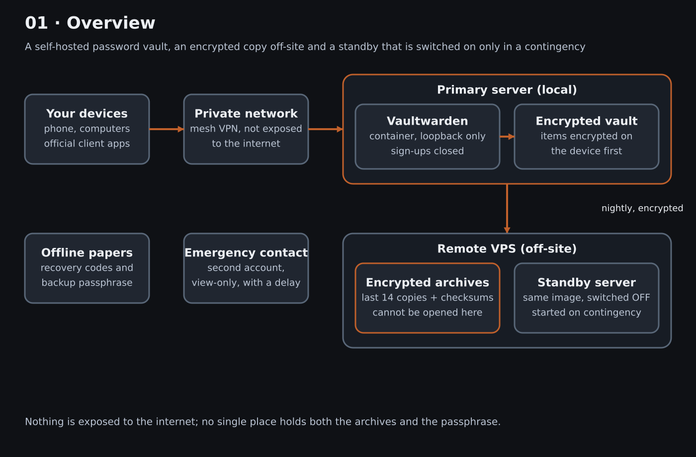

# Architecture and software

[Versión en español](architecture.md)

## Components

| Part | Role | Notes |
|---|---|---|
| Primary server | runs the vault for daily use | a small Linux machine at home, container on loopback |
| Private network | the only way in | a mesh VPN; no open port, no public address |
| Remote VPS | keeps encrypted archives and a switched-off standby | a small cloud server with no route to the home network |
| Standby server | the same image, started only in a contingency | restores from the latest archive |
| Offline papers | root secrets | recovery codes and backup passphrase |
| Emergency contact | second account, view-only | opens after a waiting time |

## Software used

| Role | Tool |
|---|---|
| Vault server | Vaultwarden, unofficial Bitwarden-compatible server, run as a container image pinned by digest |
| Clients | official Bitwarden apps and browser extensions |
| Containers | Docker and Compose |
| Private network | a mesh VPN such as Tailscale, Headscale or plain WireGuard |
| Database snapshots | SQLite backup API, through Python 3 |
| Backup encryption | GnuPG, symmetric AES-256 |
| Transport | OpenSSH with a restricted key and a forced command |
| Scheduling | systemd timers |
| Authenticator and keys | any TOTP app and FIDO2 hardware keys |

## Data flow

1. Devices talk to the primary server through the private network. Items are encrypted before they leave the device.
2. Every night the primary takes a consistent snapshot, encrypts it, checks it by decrypting, and sends it to the remote host.
3. The remote host validates the file type, stores it with a checksum and keeps the last copies. It cannot open them.
4. In a contingency a person restores the latest archive into the standby and starts it.

The scripts are in `src/`; every path comes from an environment file, nothing is hard-coded. An optional second cloud copy of the same encrypted archive is possible and adds no new secret.
