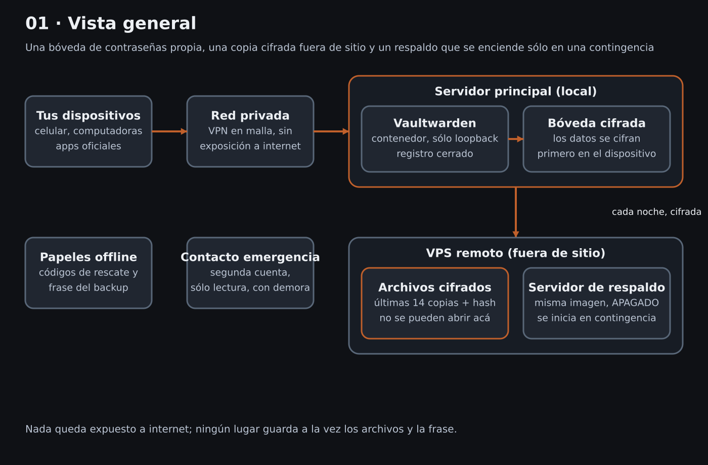

# Arquitectura y software

[English version](architecture.en.md)

## Componentes

| Parte | Función | Notas |
|---|---|---|
| Servidor principal | corre la bóveda para el uso diario | una máquina Linux chica en casa, contenedor en loopback |
| Red privada | la única entrada | una VPN en malla; sin puertos abiertos ni dirección pública |
| VPS remoto | guarda archivos cifrados y un respaldo apagado | un servidor chico en la nube sin ruta a la red de casa |
| Servidor de respaldo | la misma imagen, iniciada sólo en contingencia | restaura desde el último archivo |
| Papeles offline | secretos raíz | códigos de recuperación y frase del backup |
| Contacto de emergencia | segunda cuenta, sólo lectura | se abre tras un tiempo de espera |

## Software utilizado

| Función | Herramienta |
|---|---|
| Servidor de la bóveda | Vaultwarden, servidor no oficial compatible con Bitwarden, como imagen de contenedor anclada por hash |
| Clientes | apps y extensiones de navegador oficiales de Bitwarden |
| Contenedores | Docker y Compose |
| Red privada | una VPN en malla como Tailscale, Headscale o WireGuard directo |
| Fotos de la base | API de backup de SQLite, a través de Python 3 |
| Cifrado de backups | GnuPG, simétrico AES-256 |
| Transporte | OpenSSH con clave restringida y comando forzado |
| Programación | timers de systemd |
| Autenticador y llaves | cualquier app TOTP y llaves físicas FIDO2 |

## Flujo de datos

1. Los dispositivos hablan con el servidor principal por la red privada. Los elementos se cifran antes de salir del dispositivo.
2. Cada noche el principal toma una foto consistente, la cifra, la verifica descifrándola y la envía al host remoto.
3. El host remoto valida el tipo de archivo, lo guarda con su hash y conserva las últimas copias. No puede abrirlas.
4. En una contingencia una persona restaura el último archivo en el respaldo y lo inicia.

Los scripts están en `src/`; cada ruta sale de un archivo de entorno, nada está escrito fijo. Es posible una segunda copia opcional del mismo archivo cifrado (drive en la nube, disco externo, NAS) y no suma ningún secreto nuevo. El servidor y el standby pueden ser físicos, virtuales o un VPS: ver [opciones](options.md).
