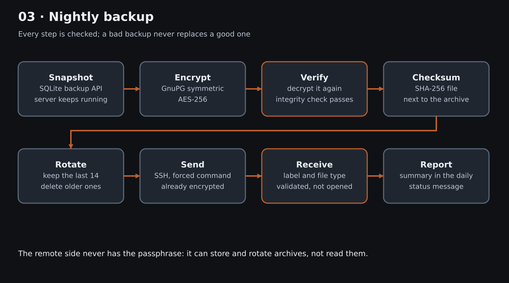

# Local and remote backup

[Versión en español](backup.md)



## Design

The primary server makes an encrypted, verified copy every night and sends it to a remote host. Three rules shape everything: **the remote side can never read the copy**, **a bad backup never replaces a good one** and **the passphrase is a different secret from the master password**.

## What a backup contains

The database (through SQLite's backup API, so the server keeps running), the server's signing key, its configuration, attachments and sends, packed in one archive and encrypted with GnuPG (AES-256). Scripts: `vw-snapshot.sh`, `vw-backup.sh`, `vw-send.sh` in `src/`.

## 1. Configure

Copy `examples/vw.env.example` to a private file, set your paths and create the passphrase file with mode 600. Make the passphrase long and random, and write it on paper in two places:

```bash
sudo install -m 600 examples/vw.env.example /etc/vw-recovery.env
head -c 48 /dev/urandom | base64 | sudo tee /path/to/backup-passphrase >/dev/null
sudo chmod 600 /path/to/backup-passphrase
```

## 2. Prepare the remote receiver

Create a dedicated SSH key on the primary and install it on the remote host with a forced command, so it can only deliver files:

```bash
ssh-keygen -t ed25519 -N "" -f ~/.ssh/vault-backup -C vault-backup-sender
# on the remote host: add to authorized_keys, using examples/authorized_keys.example
# restrict,command="/path/to/vw-receive.sh" ssh-ed25519 AAAA... vault-backup-sender
```

The receiver accepts only a UTC timestamp label and a passphrase-encrypted GnuPG file, stores it with a SHA-256 checksum and keeps the last 14 copies.

## 3. Schedule it

Install `examples/vw-backup.service` and `examples/vw-backup.timer`, then enable the timer and run one backup by hand:

```bash
sudo systemctl enable --now vw-backup.timer
sudo systemctl start vw-backup.service && journalctl -u vw-backup.service -n 20
```

## 4. Verify and rehearse

The script decrypts every new archive and runs the database integrity check before keeping it. The test suite proves the whole chain on a fake vault without Vaultwarden or Docker:

```bash
bash tests/test_backup_restore.sh
```

Add the age of the last backup to your daily status message and treat anything older than a day and a half as an alert. Rehearse a full restore at least every quarter, see [recovery](recovery.en.md).
