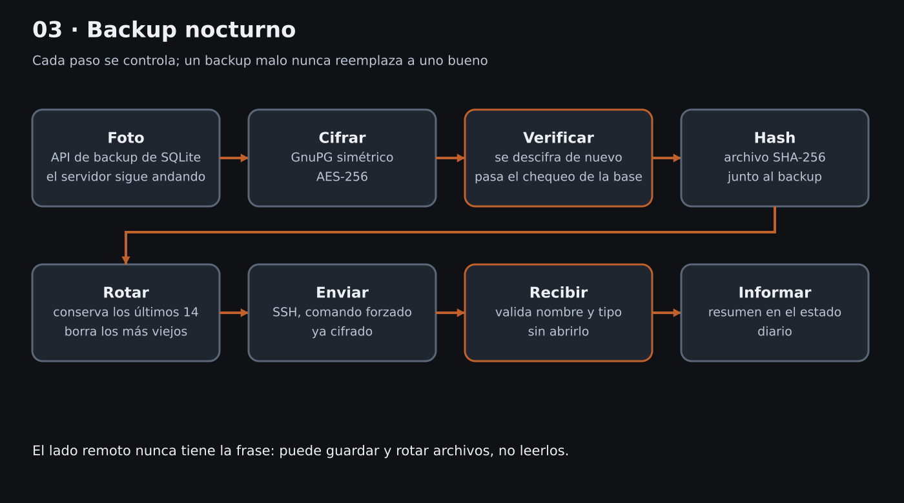

# Backup local y remoto

[English version](backup.en.md)



## Diseño

El servidor principal hace cada noche una copia cifrada y verificada y la envía a un host remoto. Tres reglas lo ordenan todo: **el lado remoto nunca puede leer la copia**, **un backup malo nunca reemplaza a uno bueno** y **la frase es un secreto distinto de la contraseña maestra**.

## Qué contiene un backup

La base de datos (con la API de backup de SQLite, así el servidor sigue andando), la clave de firma del servidor, su configuración, adjuntos y envíos, empaquetados en un archivo y cifrados con GnuPG (AES-256). Scripts: `vw-snapshot.sh`, `vw-backup.sh`, `vw-send.sh` en `src/`.

## 1. Configurar

Copiá `examples/vw.env.example` a un archivo privado, poné tus rutas y creá el archivo de la frase con modo 600. Hacé la frase larga y al azar, y escribila en papel en dos lugares:

```bash
sudo install -m 600 examples/vw.env.example /etc/vw-recovery.env
head -c 48 /dev/urandom | base64 | sudo tee /ruta/a/frase-backup >/dev/null
sudo chmod 600 /ruta/a/frase-backup
```

## 2. Preparar el receptor remoto

Creá una clave SSH dedicada en el principal e instalala en el host remoto con un comando forzado, para que sólo pueda entregar archivos:

```bash
ssh-keygen -t ed25519 -N "" -f ~/.ssh/vault-backup -C vault-backup-sender
# en el host remoto: agregar a authorized_keys, usando examples/authorized_keys.example
# restrict,command="/ruta/a/vw-receive.sh" ssh-ed25519 AAAA... vault-backup-sender
```

El receptor acepta sólo una etiqueta de fecha UTC y un archivo GnuPG cifrado con frase, lo guarda con su hash SHA-256 y conserva las últimas 14 copias.

## 3. Programarlo

Instalá `examples/vw-backup.service` y `examples/vw-backup.timer`, activá el timer y corré un backup a mano:

```bash
sudo systemctl enable --now vw-backup.timer
sudo systemctl start vw-backup.service && journalctl -u vw-backup.service -n 20
```

## 4. Verificar y ensayar

El script descifra cada archivo nuevo y corre el chequeo de integridad de la base antes de conservarlo. La suite de pruebas demuestra toda la cadena sobre una bóveda falsa sin Vaultwarden ni Docker:

```bash
bash tests/test_backup_restore.sh
```

Sumá la antigüedad del último backup a tu mensaje de estado diario y tomá como alerta todo lo que pase de día y medio. Ensayá una restauración completa al menos cada trimestre, ver [recuperación](recovery.md).
