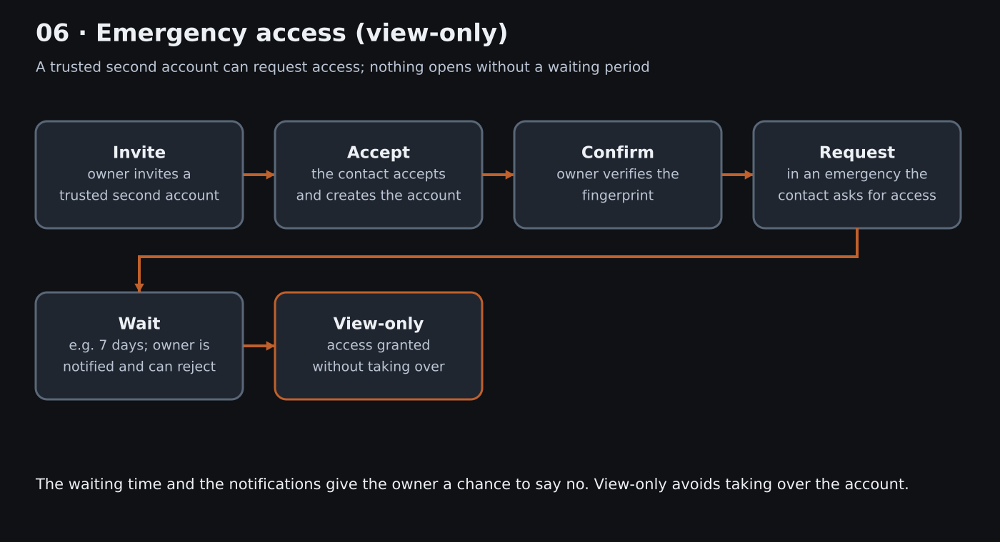

# Emergency access: a second, view-only account

[Versión en español](emergency-access.md)



## What it is for

If the owner cannot unlock the vault (illness, accident, a forgotten master password), a **trusted second account** can ask for access. The owner is told, can refuse, and if nothing happens the request is granted after a waiting time. It is the safety net for the one secret that has no reset.

## Choose the access level

- **View** (recommended): the contact can read the items, nothing more.
- **Takeover**: the contact can set a new master password and own the account. Avoid it unless that is exactly the intent.

Pick a person you would trust with the keys, tell them in person what this is, and agree a waiting time you can live with (for example seven days).

## Set it up

1. Create the contact's own account on the server. Sign-ups are closed, so open them for the minute needed and let the contact register on their device, then close them again:

   ```bash
   # compose.yml, only while the contact registers:
   SIGNUPS_ALLOWED: "true"
   ```

2. As the owner, open the vault settings, *Emergency access*, add the contact, choose *View* and the waiting time.
3. The contact accepts the invitation from their account; the owner confirms by checking the fingerprint phrase together.
4. The contact enables a second factor on their own account and writes down their own recovery codes.

## Make notifications work

The invitation and the "someone requested access" notices are sent by e-mail. Configure outgoing mail on the server (an SMTP relay) or check the emergency access page on a schedule; without notices the owner could miss a request during the waiting time.

## Test it once

Run a full request with a short waiting time, confirm the owner is notified, refuse it, and then set the real waiting time. Write the procedure on the same paper as the other root secrets so the contact knows what to do.
