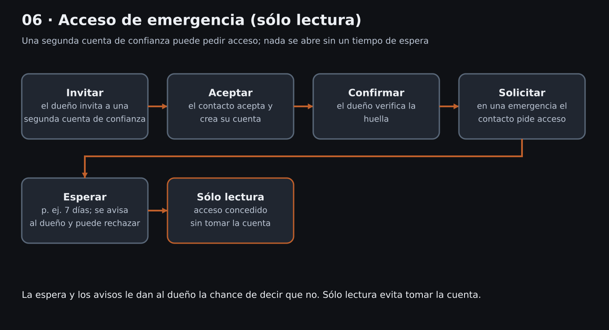

# Acceso de emergencia: una segunda cuenta de sólo lectura

[English version](emergency-access.en.md)



## Para qué sirve

Si el dueño no puede abrir la bóveda (enfermedad, accidente, contraseña maestra olvidada), una **segunda cuenta de confianza** puede pedir acceso. Se le avisa al dueño, que puede rechazarlo, y si no pasa nada el pedido se concede tras un tiempo de espera. Es la red de seguridad del único secreto que no tiene restablecimiento.

## Elegir el nivel de acceso

- **Ver** (recomendado): el contacto puede leer los elementos, nada más.
- **Tomar el control**: el contacto puede fijar una contraseña maestra nueva y quedarse con la cuenta. Evitalo salvo que sea justo la intención.

Elegí a una persona a quien le confiarías las llaves, explicale en persona de qué se trata y acordá un tiempo de espera que puedas aceptar (por ejemplo siete días).

## Configurarlo

1. Creá la cuenta propia del contacto en el servidor. El registro está cerrado: abrilo el minuto necesario, que el contacto se registre desde su dispositivo y volvé a cerrarlo:

   ```bash
   # compose.yml, sólo mientras el contacto se registra:
   SIGNUPS_ALLOWED: "true"
   ```

2. Como dueño, abrí los ajustes de la bóveda, *Acceso de emergencia*, agregá al contacto y elegí *Ver* y el tiempo de espera.
3. El contacto acepta la invitación desde su cuenta; el dueño confirma verificando juntos la frase de huella.
4. El contacto activa un segundo factor en su cuenta y anota sus propios códigos de recuperación.

## Hacer que los avisos funcionen

La invitación y los avisos de "alguien pidió acceso" se envían por correo. Configurá el correo saliente en el servidor (un relé SMTP) o revisá la página de acceso de emergencia con regularidad; sin avisos el dueño podría perderse un pedido durante la espera.

## Probarlo una vez

Hacé un pedido completo con un tiempo de espera corto, confirmá que se le avisa al dueño, rechazalo y recién entonces fijá el tiempo real. Escribí el procedimiento en el mismo papel que los demás secretos raíz para que el contacto sepa qué hacer.
