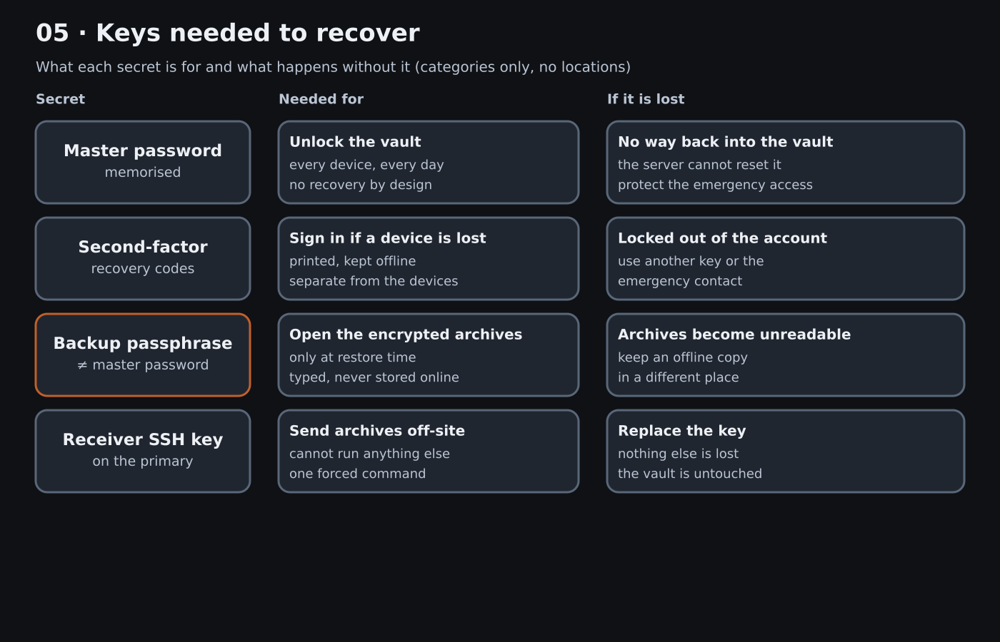
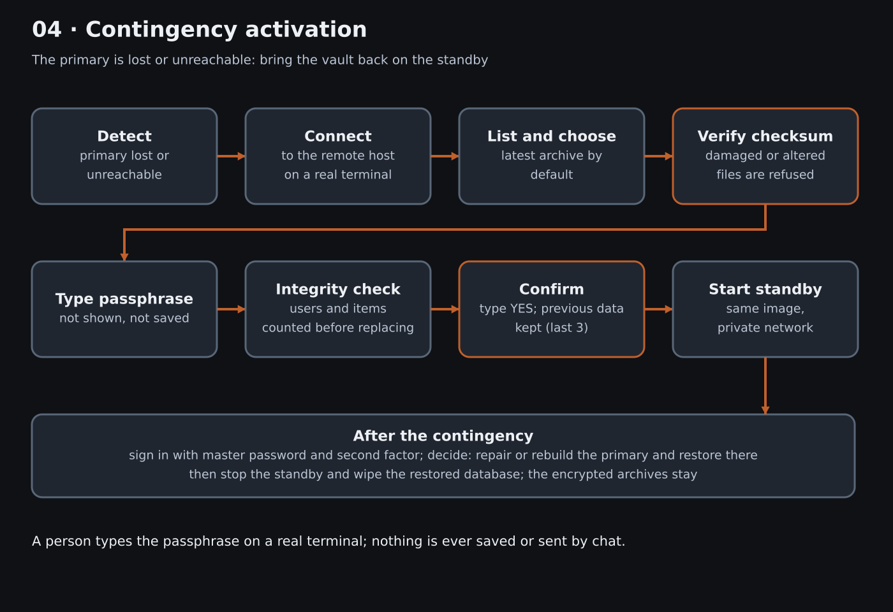

# Recovery and contingency activation

[Versión en español](recovery.md)



## Keys you need to recover

| Secret | Needed for | If lost |
|---|---|---|
| Master password | unlock the vault | no recovery by design: the emergency contact is the safety net |
| Second-factor recovery codes | sign in without a device | use another key or the emergency contact |
| Backup passphrase | open the encrypted archives | the archives become unreadable: keep an offline copy |
| Receiver SSH key | send archives off-site | replace it; nothing else is lost |

Keep the root secrets on paper, in two separate places. This document lists categories, not locations.



## When to activate

The primary server is lost, damaged or unreachable and cannot be repaired within the time you can tolerate. If only a device is lost, do not activate: use the second factor and revoke sessions.

## Procedure

Run it from a machine that can reach the remote host, on a **real terminal** because the passphrase is typed:

```bash
ssh -t standby-host sudo /path/to/vw-restore.sh --list      # see the archives
ssh -t standby-host sudo /path/to/vw-restore.sh             # latest: checksum, passphrase, check, YES
ssh -t standby-host sudo /path/to/vw-restore.sh --status    # users and items restored
```

1. The script refuses an archive whose checksum does not match.
2. You type the passphrase; it is not shown or stored.
3. The database is checked and its users and items are counted before anything is replaced.
4. You type YES. The previous data is kept (last three copies) and the standby starts.
5. Sign in on the standby's private address with the master password and second factor.

## After the contingency

Decide whether to repair or rebuild the primary and restore there with the same script. Then stop the standby and remove the restored database; the encrypted archives stay:

```bash
ssh -t standby-host sudo /path/to/vw-restore.sh --stop
ssh -t standby-host sudo /path/to/vw-restore.sh --wipe-db
```

## Rehearsal

Practise the whole procedure every quarter with a real archive, and write down how long it took. A contingency nobody has tried is a hope, not a plan.
