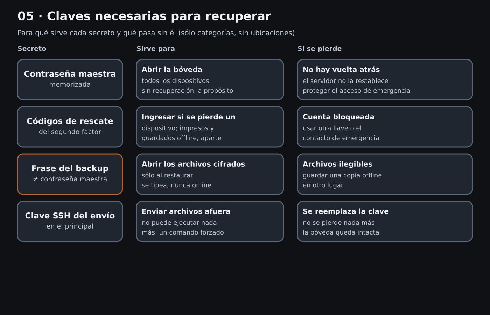
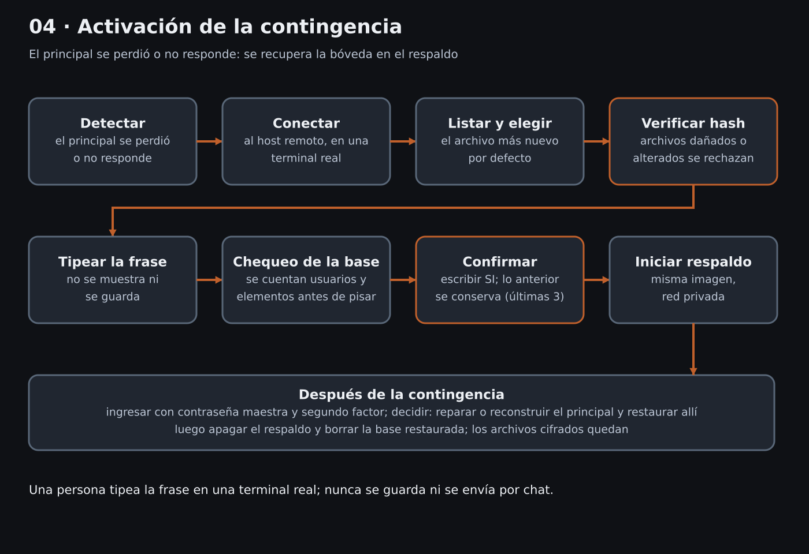

# Recuperación y activación de la contingencia

[English version](recovery.en.md)



## Claves que necesitás para recuperar

| Secreto | Sirve para | Si se pierde |
|---|---|---|
| Contraseña maestra | abrir la bóveda | sin recuperación, a propósito: el contacto de emergencia es la red de seguridad |
| Códigos de recuperación del segundo factor | ingresar sin un dispositivo | usar otra llave o el contacto de emergencia |
| Frase del backup | abrir los archivos cifrados | los archivos quedan ilegibles: guardá una copia offline |
| Clave SSH del receptor | enviar archivos afuera | se reemplaza; no se pierde nada más |

Guardá los secretos raíz en papel, en dos lugares separados. Este documento lista categorías, no ubicaciones.



## Cuándo activarla

El servidor principal se perdió, se dañó o no responde y no puede repararse en el tiempo que tolerás. Si sólo se perdió un dispositivo, no la actives: usá el segundo factor y revocá las sesiones.

## Procedimiento

Hacelo desde una máquina que llegue al host remoto, en una **terminal real** porque la frase se tipea:

```bash
ssh -t host-respaldo sudo /ruta/a/vw-restore.sh --list      # ver los archivos
ssh -t host-respaldo sudo /ruta/a/vw-restore.sh             # último: hash, frase, chequeo, YES
ssh -t host-respaldo sudo /ruta/a/vw-restore.sh --status    # usuarios y elementos restaurados
```

1. El script rechaza un archivo cuyo hash no coincide.
2. Tipeás la frase; no se muestra ni se guarda.
3. Se chequea la base y se cuentan sus usuarios y elementos antes de reemplazar nada.
4. Escribís YES. Lo anterior se conserva (últimas tres copias) y el respaldo arranca.
5. Ingresá en la dirección privada del respaldo con la contraseña maestra y el segundo factor.

## Después de la contingencia

Decidí si reparar o reconstruir el principal y restaurar allí con el mismo script. Después apagá el respaldo y borrá la base restaurada; los archivos cifrados quedan:

```bash
ssh -t host-respaldo sudo /ruta/a/vw-restore.sh --stop
ssh -t host-respaldo sudo /ruta/a/vw-restore.sh --wipe-db
```

## Ensayo

Practicá todo el procedimiento cada trimestre con un archivo real y anotá cuánto tardó. Una contingencia que nadie probó es una esperanza, no un plan.
