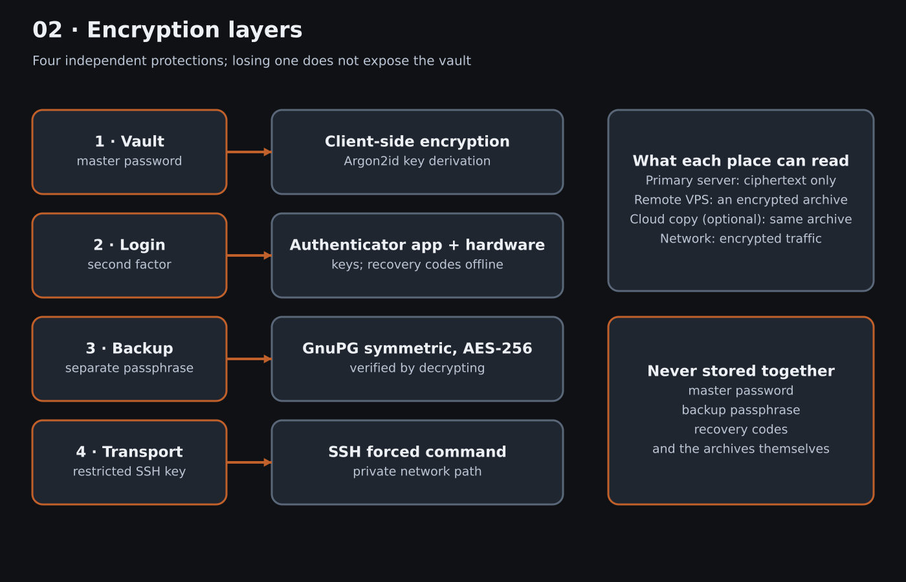

# Security model and checklist

[Versión en español](security.md)

## What this protects against

Theft or loss of a device, a compromised remote host, a leaked backup, phishing, reused passwords and the loss of the server itself. It does **not** protect a vault whose master password is weak or typed on a hostile computer.

## Encryption

- **The vault is encrypted on the client.** The server only stores ciphertext; its operator cannot read the items.
- **Key derivation** uses Argon2id with parameters at least as strong as the client's defaults; raise them as hardware allows.
- **Backups are encrypted a second time** with GnuPG (AES-256) using a passphrase that is *different* from the master password, and are verified by decrypting them. The remote host never has that passphrase.
- **Transport** is a private network plus an SSH key restricted to one forced command.

## Second factor

Use an authenticator app **and** two hardware security keys, and print the recovery codes. Keep the codes offline, apart from the devices. The authenticator app itself needs a backup or transfer plan: losing the phone must not lock you out.

## Network and server

- The server listens on loopback only and is published to your devices through a private mesh VPN. No port is open to the internet.
- Sign-ups and invitations stay closed except for the minute needed to create accounts.
- The admin page stays off, or is protected by a hashed token and used only temporarily.
- The image is pinned by digest and updated on a schedule, primary and standby together.
- The container drops capabilities and cannot gain new privileges.
- SSH accepts keys only. The remote host has no route to the home network, and the standby stays switched off.

## Browsers and clients

- Disable password saving and password autofill in every browser; use the manager's extension instead.
- If a browser keeps passwords anyway, its account must have a second factor, the device a lock and the disk encryption.
- Check the domain before autofilling and never type the master password from an e-mail link.

## Checklist

1. Long master password, memorised, never stored digitally.
2. Argon2id key derivation raised.
3. Authenticator app plus two hardware keys; recovery codes on paper.
4. Sign-ups and invitations closed; admin page off.
5. Loopback only, reached through a private network.
6. Image pinned and updated on a schedule.
7. Keys-only SSH; one dedicated key, one forced command, for backups.
8. Encrypted backup with its own passphrase, verified, rotated.
9. A restore rehearsal at least every quarter.
10. A daily status line that shows the age of the last backup.
11. Root secrets on paper in two separate places.
12. Browsers do not remember passwords.
13. Emergency access configured and tested.
14. No secrets in chat, notes, repositories or assistants.
15. Owner and operator accounts separated; tokens with small scope and spending caps.
16. A lost-device routine: revoke sessions, rotate affected keys.
