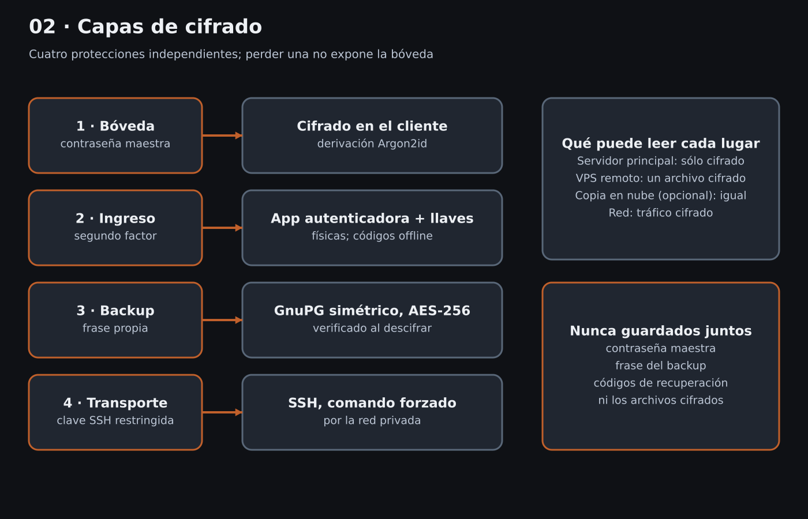

# Modelo de seguridad y lista de control

[English version](security.en.md)

## Contra qué protege

Robo o pérdida de un dispositivo, un host remoto comprometido, un backup filtrado, phishing, contraseñas repetidas y la pérdida del propio servidor. **No** protege una bóveda con contraseña maestra débil o tipeada en una computadora hostil.

## Cifrado

- **La bóveda se cifra en el cliente.** El servidor sólo guarda texto cifrado; quien lo administra no puede leer los elementos.
- **La derivación de clave** usa Argon2id con parámetros al menos tan fuertes como los del cliente por defecto; subilos cuanto permita el equipo.
- **Los backups se cifran una segunda vez** con GnuPG (AES-256) usando una frase *distinta* de la contraseña maestra, y se verifican descifrándolos. El host remoto nunca tiene esa frase.
- **El transporte** es una red privada más una clave SSH restringida a un solo comando forzado.

## Segundo factor

Usá una app autenticadora **y** dos llaves físicas de seguridad, e imprimí los códigos de recuperación. Guardá los códigos offline, aparte de los dispositivos. La propia app autenticadora necesita un plan de respaldo o traspaso: perder el celular no debe dejarte afuera.

## Red y servidor

- El servidor escucha sólo en loopback y se publica a tus dispositivos por una VPN en malla privada. Ningún puerto queda abierto a internet.
- El registro y las invitaciones quedan cerrados salvo el minuto necesario para crear las cuentas.
- La página de administración queda apagada, o protegida con un token con hash y usada sólo temporalmente.
- La imagen se ancla por hash y se actualiza en un calendario, principal y respaldo juntos.
- El contenedor descarta capacidades y no puede ganar privilegios nuevos.
- SSH acepta sólo llaves. El host remoto no tiene ruta a la red de casa, y el respaldo permanece apagado.

## Navegadores y clientes

- Desactivá el guardado y el autocompletado de contraseñas en todos los navegadores; usá la extensión del gestor.
- Si un navegador igual guarda contraseñas, su cuenta debe tener segundo factor, el equipo un bloqueo y el disco cifrado.
- Verificá el dominio antes de autocompletar y nunca tipees la contraseña maestra desde un enlace de correo.

## Lista de control

1. Contraseña maestra larga, memorizada, nunca guardada digitalmente.
2. Derivación de clave Argon2id elevada.
3. App autenticadora más dos llaves físicas; códigos de recuperación en papel.
4. Registro e invitaciones cerrados; página de administración apagada.
5. Sólo loopback, accedido por una red privada.
6. Imagen anclada y actualizada en un calendario.
7. SSH sólo con llaves; una clave dedicada, un comando forzado, para los backups.
8. Backup cifrado con su propia frase, verificado y rotado.
9. Un ensayo de restauración al menos cada trimestre.
10. Una línea de estado diaria que muestre la antigüedad del último backup.
11. Secretos raíz en papel en dos lugares separados.
12. Los navegadores no recuerdan contraseñas.
13. Acceso de emergencia configurado y probado.
14. Ningún secreto en chats, notas, repositorios ni asistentes.
15. Cuentas propietarias y de operación separadas; tokens con poco alcance y topes de gasto.
16. Una rutina de dispositivo perdido: revocar sesiones, rotar las claves afectadas.
